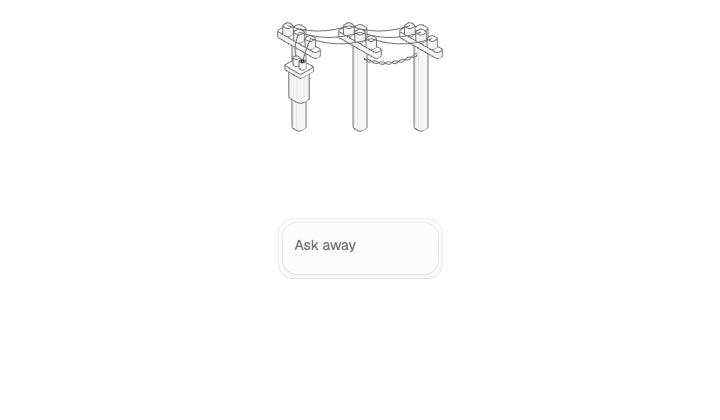

# Voltable

Ask plain-English questions about utility construction standards. Get answers with exact quotes, cited pages, and the drawing — not a guess.



## Why

On a live call, a planner needs the rule, the page, and the dimension — fast. Voltable searches five SCE standards manuals (ESR, ADS, DOH, PLM, UGS) locally and answers only from what it can cite. No sources, no answer.

## Run it

Download **Voltable.app** from Releases and open it. Everything runs on your machine, including the AI (via Ollama). No account, no cloud.

## Build it yourself

Requires Node 22, Python 3.13, Ollama with `qwen2.5:latest`, and the five manual PDFs in the parent folder (see `src/lib/rag/docs.ts` for filenames).

```bash
npm install
npm run ingest:manuals   # build the search index + evidence images
bash scripts/app/build-app.sh   # produces ESR Assistant.app in dist/stage
```

`npm run eval:manuals` runs the 75-question regression suite. All 13 gates must pass.
